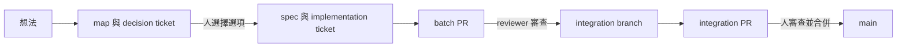

# wayfinder-loops

wayfinder-loops 是一個 Claude Code plugin。它用 GitHub Issues 與 GitHub Project 看板,把一個想法推進到合併進 main 的程式碼。

完整說明請看報告書:https://taisianghuang.github.io/wayfinder-loops-guide/

## 說明

### 用途

wayfinder-loops 讓 agent 做開 ticket、查證、實作、審查與合併 batch PR。人只做兩件事:

1. 在 decision ticket 上選一個選項。
2. 審查並合併 integration PR。

### 組成

wayfinder-loops 有五條 loop 與一個 agent。每條 loop 依固定間隔執行一輪。

| 名稱 | 種類 | 工作 |
| --- | --- | --- |
| cartographer | loop | 把想法寫成 map 與 decision ticket。決策完成後,寫 spec 與 implementation ticket。 |
| resolver | loop | 讀人在 decision ticket 上的選擇。記錄結論並關閉 decision ticket。 |
| researcher | loop | 查證外部事實。把結果寫在 decision ticket 上並關閉。 |
| implementer | loop | 實作 implementation ticket,開 batch PR,合併 batch PR 到 integration branch,開 integration PR。 |
| prototyper | loop | 人要求原型時,做原型頁與截圖。 |
| reviewer | agent | 審查每個 batch PR。修正問題,判斷風險,把 PR 設為 ready。implementer 派出 reviewer。 |

GitHub label 是唯一的狀態來源。loop 不保存狀態。看板欄位由 workflow 依 label 計算。

### 流程



## 名詞

本文件中每個名詞只有一個意思。

| 名詞 | 意思 |
| --- | --- |
| planning repo | 放想法、map、decision ticket、spec 與 `wayfinder.yml` 的 repo。 |
| code repo | 放程式碼、implementation ticket 與 PR 的 repo。可以有多個。 |
| map | 記錄一個想法的目標、已做的決定與未定問題的 issue。 |
| decision ticket | map 中一個待決問題的 issue。由人做決定,或由 researcher 查證事實。附有選項表與建議。 |
| implementation ticket | 要求 agent 實作一項變更的 issue。 |
| integration branch | 一個 spec 的所有變更先合併到的分支,名稱為 `spec/<編號>-<名稱>`。 |
| batch PR | implementation ticket 的 PR。目標分支是 integration branch。人不審查 batch PR。 |
| integration PR | 從 integration branch 到 main 的 PR。每個 spec 只有一個。人審查這個 PR。 |
| one-way door | 合併後不能撤回的變更。例如:資料庫 migration、資料刪除、權限變更、對外發送訊息。 |

## 需求

- Claude Code 2.1.275 或更新版本。
- `gh` CLI 2.94 或更新版本。token 要有 `project` scope。
- 一個 GitHub organization,內有一個 planning repo、一個或多個 code repo、一個 Project 看板。
- 一個 classic personal access token,scope 為 `repo` 與 `project`。
- 每個 code repo 要有一個能在本機執行的 CI 指令。

## 安裝

1. 在 Claude Code 中,加入 marketplace:

   ```text
   /plugin marketplace add taisianghuang/wayfinder-loops
   ```

2. 安裝 plugin:

   ```text
   /plugin install wayfinder-loops@wayfinder-loops
   ```

   此步驟也會安裝 mattpocock-skills。

3. 輸入 `planning_repo`。格式為 `owner/name`。
4. 輸入 `workspace_dir`。這是放 code repo clone 的資料夾。

注意:要修改這兩個值,執行 `/plugin`,選 wayfinder-loops,選 Configure。

## 設定

注意:第二階段會提供 `/wayfinder-loops:setup`,自動執行步驟 2 到 7。

1. 把每個 code repo clone 到 `workspace_dir`。
2. 把 [`templates/wayfinder.yml`](templates/wayfinder.yml) 複製到 planning repo 的根目錄。
3. 在 `wayfinder.yml` 中,填寫每個 code repo 的 `repo`、`dir` 與 `ci`。欄位說明在 [`references/config.md`](references/config.md)。
4. 建立 label。在 plugin 的安裝資料夾執行 `scripts/setup-labels.sh`,參數為 planning repo 與每個 code repo:

   ```bash
   bash scripts/setup-labels.sh my-org/planning my-org/api my-org/web
   ```

   注意:執行 `claude plugin list --json`,`installPath` 欄位是 plugin 的安裝資料夾。

5. 建立 org Project 看板。把 Status 欄位設為 13 個值。值的清單在報告書第 03 章。

   警告:Status 值必須與清單完全相同,包含 emoji 與空格。不同時,看板不會更新。

6. 在 planning repo 與每個 code repo,設定以下項目:

   | 名稱 | 種類 | 值 |
   | --- | --- | --- |
   | `PROJECT_URL` | variable | 看板網址 |
   | `PLANNING_REPO` | variable | planning repo,格式為 `owner/name` |
   | `PROJECT_TOKEN` | secret | personal access token |
   | `ORG_AUTOMATION_TOKEN` | secret | personal access token |

7. 把 [`workflows/`](workflows/) 中的三個檔案複製到每個 repo 的 `.github/workflows/`。
8. 執行健檢:

   ```text
   /wayfinder-loops:doctor
   ```

9. 確認所有項目是 ✅。有 ❌ 時,依 doctor 的說明修正,再執行步驟 8。

## 啟動

警告:每條 loop 只能有一個執行中的 session。兩個相同的 loop 會實作同一張 implementation ticket 兩次。

1. 開五個終端機。
2. 在每個終端機,進入 `workspace_dir`,啟動 Claude Code。
3. 在每個終端機,執行一行指令:

   ```text
   /loop 10m /wayfinder-loops:resolver
   /loop 20m /wayfinder-loops:cartographer
   /loop 15m /wayfinder-loops:researcher
   /loop 15m /wayfinder-loops:implementer
   /loop 30m /wayfinder-loops:prototyper
   ```

注意:`/loop` 排程在 7 天後到期。到期後,重新執行步驟 3。

## 日常操作

### 加入一個想法

1. 在 planning repo 建立一個 issue。
2. 寫下想法。不要加 label。

### 做決定

1. 開啟看板。
2. 開啟「⏳ 等你決定」欄中的卡片。
3. 讀 decision ticket 中的選項表與建議。
4. 加一個 label:

   | Label | 意思 |
   | --- | --- |
   | `decision:a`、`decision:b`、`decision:c` | 選擇該選項 |
   | `decision:approve` | 選擇建議的選項 |
   | `decision:discuss` | 要求說明。resolver 會回覆。 |

注意:也可以用留言回覆。留言要指出一個選項。

### 審查 integration PR

1. 開啟看板。
2. 開啟「👀 待你 review」欄中的 integration PR。
3. 讀 PR 說明最上方的「審這裡」清單。
4. 審查清單中的每個 one-way door。
5. 確認 implementer 的報告寫著「落後 0、閘門綠」。
6. 合併 PR。

警告:只有人可以合併 integration PR。不要讓 agent 合併 integration PR。

## 更新

1. 執行:

   ```text
   /plugin marketplace update wayfinder-loops
   /plugin update wayfinder-loops@wayfinder-loops
   /reload-plugins
   ```

## 移除

1. 執行:

   ```text
   /plugin uninstall wayfinder-loops@wayfinder-loops
   ```

注意:此操作不會移除 GitHub 上的 label、看板與 workflow。

## 故障排除

先執行 `/wayfinder-loops:doctor`。

| 症狀 | 原因 | 處理 |
| --- | --- | --- |
| 看板卡片不移動 | Status 值與清單不同,或缺少 `PROJECT_URL`、`PROJECT_TOKEN` | 比對 Status 值。檢查 variable 與 secret。 |
| loop 看不到看板上的卡片 | 卡片是 draft,不是 issue | 在卡片上選 Convert to issue,選 planning repo。 |
| implementation ticket 停在「📋 排隊中」 | 升級事件沒有觸發 | 在該 repo 的 Actions 頁,手動執行 `promote-queued`。 |
| `promote-queued` 失敗 | 缺少 `PLANNING_REPO` variable | 設定 `PLANNING_REPO`。 |
| implementation ticket 有 `agent:blocked` | 實作或審查失敗 | 讀 implementation ticket 上 `🤖 [implementer]` 或 `🤖 [reviewer]` 的留言。修正後移除 `agent:blocked`。 |
| 同一張 implementation ticket 被實作兩次 | 同一條 loop 有兩個 session | 關閉一個 session。 |

## 參考

| 文件 | 內容 |
| --- | --- |
| [報告書](https://taisianghuang.github.io/wayfinder-loops-guide/) | 專案介紹、角色、看板管理、建立工作流 |
| [LOOP.md](LOOP.md) | 人的日常操作 |
| [references/config.md](references/config.md) | 設定欄位 |
| [references/contract.md](references/contract.md) | 所有 loop 共用的規則 |
| [docs/design-public-kit.md](docs/design-public-kit.md) | plugin 的設計 |
| [docs/design-notes.md](docs/design-notes.md) | 早期的設計修正紀錄 |

## 致謝

- [mattpocock/skills](https://github.com/mattpocock/skills) 提供 wayfinder、to-spec、to-tickets、implement、code-review 等 skill。
- reviewer 的設計來自 Matt Pocock 的演講〈Fixing the PR Bottleneck〉(AI Engineer Paris 2026)。

## 授權

[MIT](LICENSE)
