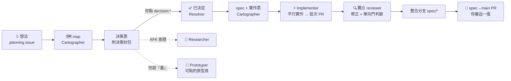

# wayfinder-loops

**讓 PM 只丟想法、點決策,工程師只審最後一張 PR 的 GitHub 自動化工作流。**

wayfinder-loops 是一個 Claude Code plugin。它在你的 GitHub Issues 與 Project 看板上跑五條 `/loop`:把模糊的想法拆成地圖(map)與決策票、查證外部事實、把定案的決策寫成 spec、切成實作票、平行實作並開 PR、經獨立 reviewer 審過後收割進整合分支。人類只出現在兩個地方:**在看板上點一個決策 label**,以及**審整份 spec 的那一張 PR**。

建立在 [mattpocock/skills](https://github.com/mattpocock/skills) 的 wayfinder、to-spec、to-tickets、implement 之上。



## 適合誰

- 小團隊,PM / SA 不碰程式碼,但要能自己丟需求、做決策。
- 已經用 GitHub Issues 管需求,願意用 GitHub Project 看板。
- 有一台能長時間開著 Claude Code 的機器,code repo 有能在本機跑完的 CI 指令。

**不適合**:沒有本機 CI 指令的 repo(批次 PR 的驗證全靠它)、GitHub 以外的 issue tracker、不能讓 agent 以你的 GitHub 帳號開票與開 PR 的環境。

## 為什麼

AI agent 讓「開 PR」變便宜,瓶頸於是移到「人來決定」與「人來審」。這套流程把人的時間只花在這兩件事上,其餘交給三層把關:

1. **本地確定性檢查**:每張批次 PR 都要跑完你設定的 CI 指令,紅燈不收。
2. **獨立 reviewer**:實作與審查分兩個 context。reviewer 只拿到 diff,對照 `CODING_STANDARDS.md`(選用)與票的規格直接 commit 修正,並判斷這張 PR 是單向門還是雙向門。
3. **人類審查一次**:整份 spec 進 main 之前開一張 PR,body 最上面列出「審這裡」清單,只有單向門(migration、權限、對外發送…)需要細看。

## 五條 loop

| Loop | 做什麼 | 建議頻率 |
|---|---|---|
| `resolver` | 讀你在決策票上的 label 或留言,記錄結論、關票、回報 map;`decision:discuss` 時回覆你的疑慮 | 10 分鐘 |
| `cartographer` | 新想法開成 map 與決策票;收斂 map;決策都定了就寫 spec、切實作票 | 20 分鐘 |
| `researcher` | 純 AFK:查證外部事實,結果貼回票上並結案 | 15 分鐘 |
| `implementer` | 收割批次 PR、認領實作票、平行派工、派獨立 reviewer、維護 spec→main PR | 15 分鐘 |
| `prototyper` | 你在原型票上說「畫」之後才動:做出手機點得開的原型頁與截圖 | 30 分鐘 |

各 loop 讀寫哪些 label、誰是唯一 writer,見下方 [Label 權威清單](#label-權威清單)。

## 前置需求

- Claude Code 2.1.275 以上
- [mattpocock-skills](https://github.com/mattpocock/skills) plugin(安裝本 plugin 時會一起裝)
- `gh` CLI ≥ 2.94,token 有 `project` scope:`gh auth refresh -h github.com -s project`
- 一個 GitHub organization:一個 planning repo + 一或多個 code repo + 一個 org Project 看板(Free 方案可用)
- 一顆 classic PAT(`repo` + `project` scope),給 workflow 寫看板與跨 repo 升級票用

## 安裝

在 Claude Code 裡:

```
/plugin marketplace add taisianghuang/wayfinder-loops
/plugin install wayfinder-loops@wayfinder-loops
```

安裝時會問兩個值:**planning repo**(`owner/name`)與**工作區資料夾**(code repo 的本機 clone 都放在這底下)。之後可用 `/plugin` → wayfinder-loops → Configure 修改。

## 初次設定

> 第二階段會提供 `/wayfinder-loops:setup` 精靈自動完成以下步驟;在那之前請手動做。

1. **clone code repo** 到工作區資料夾底下。
2. **建 label**(三類 repo 都要;冪等,可重跑):
   ```bash
   bash "$(claude plugin list --json | python3 -c "import sys,json;print(next(p['installPath'] for p in json.load(sys.stdin) if p['id']=='wayfinder-loops@wayfinder-loops'))")/scripts/setup-labels.sh" my-org/planning my-org/api my-org/web
   ```
3. **建 org Project 看板**:New project → Board,Status 欄位改成這 13 個值(**逐字一致**,含 emoji 與空格,workflow 用字串比對):
   `⏳ 等你決定`,`🔍 準備選項中`,`💬 討論中`,`💡 收件匣`,`🗺️ 規劃中`,`🤖 查證中`,`✅ 已決定,待收斂`,`📋 排隊中`,`🚀 可實作`,`⚡ 實作中`,`👀 待你 review`,`🚫 卡住`,`✔️ 已關閉`。
   再加上 Sub-issues progress、Assignees、Repository 欄位;Workflows → Auto-add to project 指向 planning repo。
4. **設 secrets / vars**(每個 repo 都要):secret `PROJECT_TOKEN`、`ORG_AUTOMATION_TOKEN`(都可用同一顆 PAT);variable `PROJECT_URL`(看板網址)、`PLANNING_REPO`(`owner/name`)。
5. **部署 workflows**:把 plugin 的 `workflows/` 三個檔案放進每個 repo 的 `.github/workflows/`。
6. **寫設定檔**:把 [`templates/wayfinder.yml`](templates/wayfinder.yml) 複製到 planning repo 根目錄,填入你的 code repo 與 CI 指令。欄位說明見 [`references/config.md`](references/config.md)。
7. **健檢**:`/wayfinder-loops:doctor`,全部 ✅ 再往下。
8. **冒煙測試**:在 planning repo 開一張寫著模糊想法的 issue,手動跑一次 `/wayfinder-loops:cartographer`,看板上應該出現在「⏳ 等你決定」。

## 啟動

每條 loop 開一個終端機,在工作區資料夾啟動 Claude Code:

```
/loop 10m /wayfinder-loops:resolver
/loop 20m /wayfinder-loops:cartographer
/loop 15m /wayfinder-loops:researcher
/loop 15m /wayfinder-loops:implementer
/loop 30m /wayfinder-loops:prototyper
```

不想讓 context 隨輪數累積,可以改用 headless 模式:`bin/wayfinder-run-loop resolver 600`(每輪開全新的 session;implementer 與 prototyper 需要寬權限,建議仍用互動式)。

**同一條 loop 只能開一個。** 平行度由 loop 內部派 subagent 取得;開兩個同名 loop 會搶同一張票。

## 日常操作

人類每天只有三個動作:看「⏳ 等你決定」欄、在決策票上點一個 `decision:*` label、審「👀 待你 review」的 spec→main PR。詳見 [LOOP.md](LOOP.md)。

## 成本與資源

- 五條 loop 長時間開著會持續消耗 token;Implementer 一輪最多派 `limits.per_round` 張票(預設 3),每張都會跑一次完整的本地 CI,外加一次 reviewer 的 CI。
- `/loop` 的排程任務 7 天後到期,session 必須一直開著。
- 一輪的成本大多在 subagent;loop 本身只掃描、認領、派工、驗收,context 不會隨輪數膨脹太多。

## 安全

- loop 以**你的 GitHub 身分**開票、留言、開 PR、合併批次 PR 進整合分支。**合併進 main 只由人類做。**
- loop 不改 `.github/workflows/`、不代貼人工核准類的 label。
- PAT 只需要 `repo` + `project`;放在 repo secret,不寫進設定檔。

## 更新與移除

```
/plugin marketplace update wayfinder-loops
/plugin update wayfinder-loops@wayfinder-loops
/reload-plugins
```

移除:`/plugin uninstall wayfinder-loops@wayfinder-loops`。GitHub 上的 label、看板、workflow 不會被移除。

## 疑難排解

先跑 `/wayfinder-loops:doctor`。常見問題:

- **看板卡片不動**:Status 選項名稱與上面 13 個值不完全一致,或 repo 沒設 `PROJECT_URL` / `PROJECT_TOKEN`。
- **看板上的卡片 loop 看不到**:看板上直接新增的 draft 要按 **Convert to issue** 轉到 planning repo。
- **`gh` 指令失敗**:版本低於 2.94,或 token 缺 `project` scope。
- **票一直停在「📋 排隊中」**:blocker 關掉時沒觸發升級;到 planning repo 的 Actions 手動執行 `promote-queued`。

## Label 權威清單

**mattpocock-skills 自己會讀寫的(10 個)**

| Label | writer |
|---|---|
| `needs-triage` / `needs-info` / `ready-for-agent` / `ready-for-human` / `wontfix` | triage、to-spec、to-tickets |
| `wayfinder:map` | wayfinder |
| `wayfinder:research` / `wayfinder:prototype` / `wayfinder:grilling` / `wayfinder:task` | wayfinder |

**本 plugin 新增的**

| Label | writer | 用途 |
|---|---|---|
| `wayfinder:ticket` | cartographer | 一次撈出所有決策票 |
| `agent:queued` / `agent:implement` / `agent:in-progress` / `agent:blocked` | 升級 workflow / loop | 實作管線的位置;`agent:blocked` 是錯誤旗標 |
| `decision:a` / `b` / `c` / `approve` / `discuss` | 只有人 | 人類的決定 |

## 不變式

- 任何 loop、任何 workflow 都不讀 Project Status 做判斷;判斷一律讀 label。
- 每個 label 只有一個 writer。
- map body 只有 Cartographer 寫。
- 決策票沒有人類新動作 → 所有 loop 對它 no-op;永不逾時自動核准。
- 實作票的 PR base 永遠是 `spec/*` 整合分支;人類只合併 spec→main 的 PR。
- 批次 PR 的驗證在本地(設定檔的 CI 指令 + 獨立 reviewer),不靠 GitHub Actions。

## 文件

- [LOOP.md](LOOP.md):人類日常操作
- [references/config.md](references/config.md):設定參考
- [references/contract.md](references/contract.md):五條 loop 共用的契約
- [docs/design-public-kit.md](docs/design-public-kit.md):公開版的設計
- [docs/design-notes.md](docs/design-notes.md):早期的設計修正紀錄

## 致謝

- [Matt Pocock](https://github.com/mattpocock/skills) 的 wayfinder 與工程類 skills 是這套流程的地基。
- 獨立 reviewer 與 Merge Danger 的設計來自 Matt Pocock 的演講〈Fixing the PR Bottleneck〉(AI Engineer Paris 2026)。

## License

[MIT](LICENSE)
